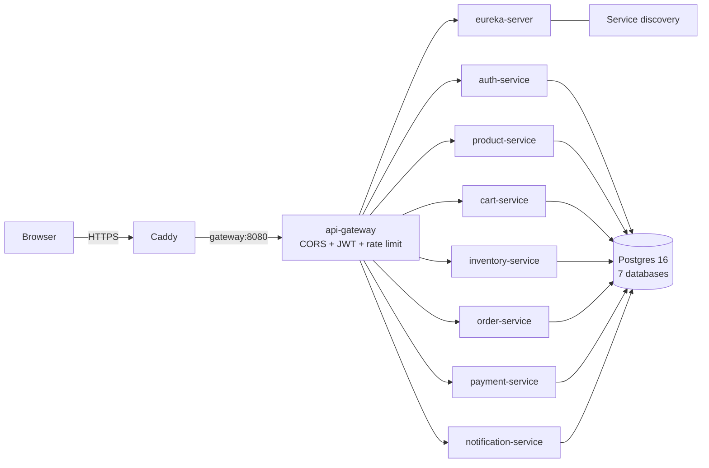

# Bazario — E-Commerce Microservices Platform

A Spring Boot microservices platform with Eureka-based service discovery and centralized API Gateway.

## Quick Start

```bash
# Start all services
./mvnw spring-boot:run -pl eureka-server
./mvnw spring-boot:run -pl api-gateway
./mvnw spring-boot:run -pl auth-service,product-service,inventory-service,order-service,payment-service,notification-service
```

## Architecture

| Service | Port | Description |
|---------|------|-------------|
| eureka-server | 8761 | Service discovery |
| api-gateway | 8080 | API Gateway (single entry point) |
| auth-service | 8081 | Authentication & authorization |
| product-service | 8082 | Product catalog |
| inventory-service | 8083 | Inventory management |
| order-service | 8084 | Order processing |
| payment-service | 8085 | Payment handling |
| notification-service | 8086 | Notifications |

## Documentation

- **[Quick Start](docs/QUICK_START.md)** - Get running in minutes
- **[Developer Reference](docs/DEVELOPER_REFERENCE.md)** - Commands, ports, troubleshooting
- **[Architecture Guide](docs/architecture/MICROSERVICES_GUIDE.md)** - Detailed architecture
- **[Implementation Summary](docs/architecture/IMPLEMENTATION_SUMMARY.md)** - What was built
- **[Verification Checklist](docs/architecture/VERIFICATION_CHECKLIST.md)** - Complete feature list

## Project Structure

```
ecommerce-server/
├── api-gateway/          # API Gateway (port 8080)
├── auth-service/         # Authentication service (port 8081)
├── eureka-server/        # Service discovery (port 8761)
├── product-service/      # Product catalog (port 8082)
├── inventory-service/    # Inventory management (port 8083)
├── order-service/        # Order processing (port 8084)
├── payment-service/      # Payment handling (port 8085)
├── notification-service/ # Notifications (port 8086)
├── docs/                 # Documentation
│   ├── architecture/     # Architecture docs
│   ├── developer/        # Developer guides
│   └── README_MICROSERVICES.md
├── spec-kit/             # Specification kit
└── pom.xml               # Parent POM
```

## Requirements

- Java 17+
- Maven 3.8+
- Docker (optional, for containerized deployment)

## Live demo (FREE infrastructure)

- **API / health:** `https://<VM-IP-WITH-DASHES>.sslip.io` (`/health` for monitors)
- **Frontend:** `https://bazario.pages.dev` (Cloudflare Pages project: `bazario`)
- **Demo login:** `demo@ecommerce.local` / `Demo@12345`

> The hostname is generated from the VM's public IP by `scripts/setup-vm.sh`.
> Replace the placeholders above with the values it prints after deployment.

## Bazario production architecture



Only Caddy publishes ports 80/443. Eureka and all business services sit on an
internal Docker network. There is **no Redis, Kafka or RabbitMQ** in this
project — caching is Caffeine (in-process), so none are deployed.

### One-time deployment (Oracle Always Free ARM VM)

See [`deploy/ORACLE-FREE-VM.md`](deploy/ORACLE-FREE-VM.md) for click-by-click
account/VM/security-list instructions. After the VM is up:

```bash
sudo git clone --branch main https://github.com/HadyKhater/ecommerce-server.git /opt/ecommerce
sudo chown -R ubuntu:ubuntu /opt/ecommerce
cd /opt/ecommerce
bash scripts/setup-vm.sh                              # .env + secrets + RSA keys
docker compose -f docker-compose.prod.yml pull
docker compose -f docker-compose.prod.yml up -d --build
docker compose -f docker-compose.prod.yml ps          # all services healthy
bash scripts/seed-demo.sh                             # demo user + smoke test
```

No capacity on ARM? See [`deploy/FALLBACK.md`](deploy/FALLBACK.md).

### Files added for production (local dev untouched)

| File | Purpose |
|------|---------|
| `Dockerfile` | Shared multi-stage build (Temurin **21** — this repo is Java 21) with one target per service |
| `docker-compose.prod.yml` | 9 services + Postgres + Caddy, healthchecks, internal networks |
| `application-prod.yml` | Per-service prod overrides (Docker DNS, env-driven DB/JWT) |
| `caddy/Caddyfile` | Automatic HTTPS via `{$CADDY_DOMAIN}` |
| `docker/postgres/init/` | Creates 7 DBs and the inventory schema (inventory-service has no Flyway dependency) |
| `scripts/setup-vm.sh` | IP detection, secrets, keys, start instructions |
| `scripts/seed-demo.sh` | Demo user + API smoke test |
| `.github/workflows/deploy-backend.yml` | Optional free redeploy-on-push (needs `VM_HOST`, `VM_USER`, `VM_SSH_KEY` secrets) |

### Monitoring

Point UptimeRobot (free) at `https://<your-domain>/health` every 5 minutes.
The gateway returns 503 when Eureka is unavailable, so this detects discovery
outages too.

### Troubleshooting

| Symptom | Likely cause | Fix |
|---------|--------------|-----|
| Containers restarting, `Connection refused` to postgres | DB not ready | Wait for `postgres` healthy; check `docker compose logs postgres` |
| Gateway 503 on all routes | Eureka not ready / registration delay | Wait 1–2 min; `curl` gateway `/actuator/health`; check Eureka dashboard inside network |
| 401 on every protected call | JWT public key mismatch | Ensure `JWT_PUBLIC_KEY` is the matching base64 public key in **both** auth-service and gateway; restart both |
| CORS error in browser | Frontend origin not allowed | Add the exact Pages URL (e.g. `https://bazario.pages.dev`) to `CORS_ALLOWED_ORIGINS` in `.env`, recreate gateway |
| `Mixed content` warning | Frontend still uses `http://` API URL | Rebuild frontend with `BACKEND_URL=https://...` |
| Out of memory / OOMKilled | JVM heap too high | Lower `JAVA_TOOL_OPTIONS` `-Xmx` per service; add swap on small VMs |
| `curl: (60) certificate` | Let's Encrypt not finished / port 80 blocked | Confirm both Oracle security list and `ufw` allow 80 + 443 |

## License

MIT
